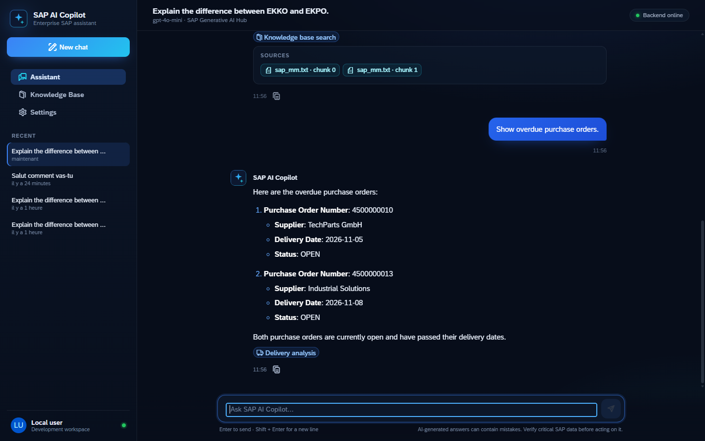
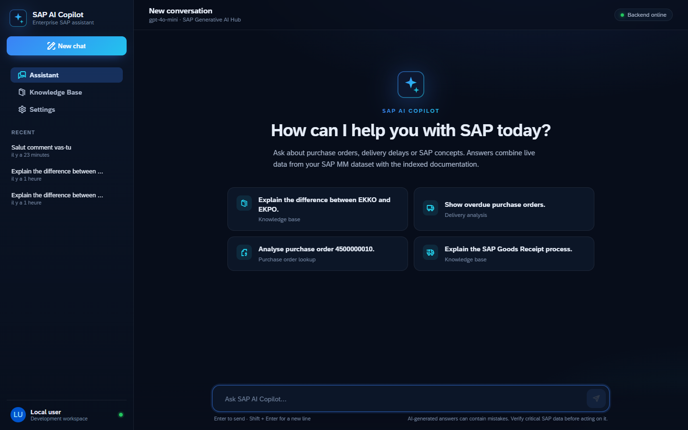
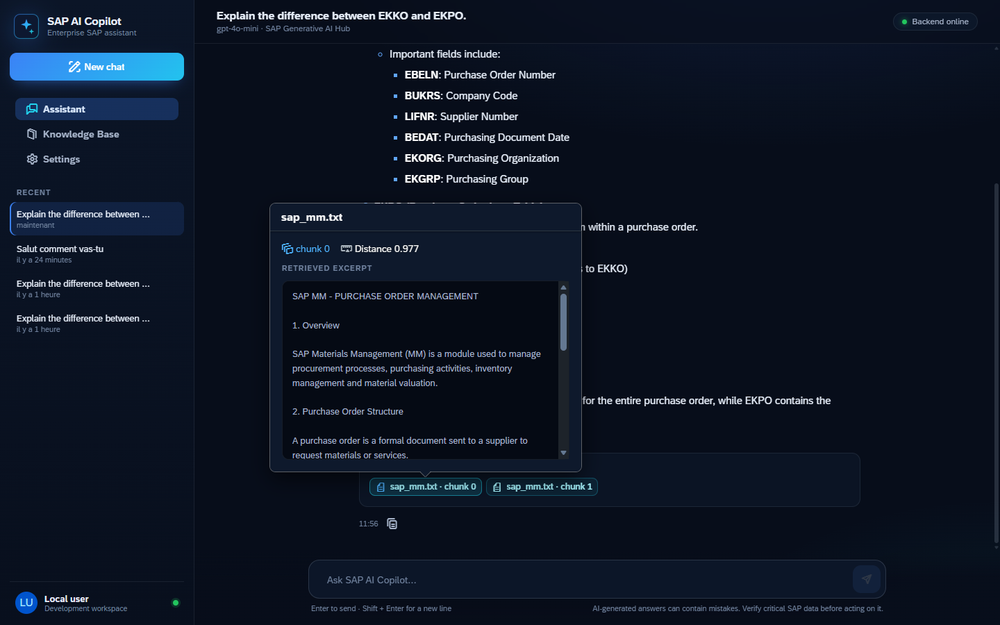
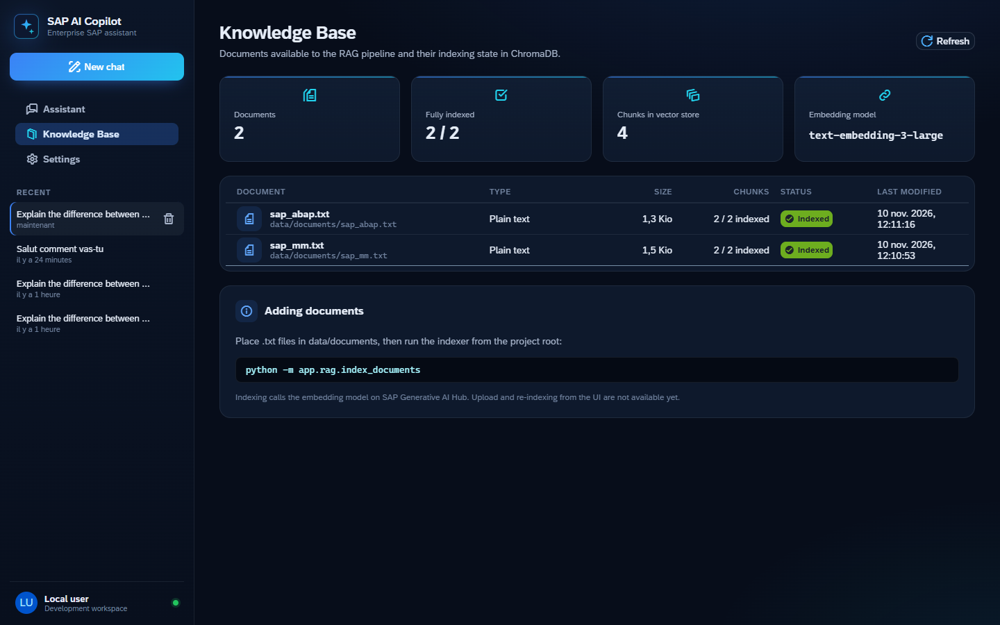
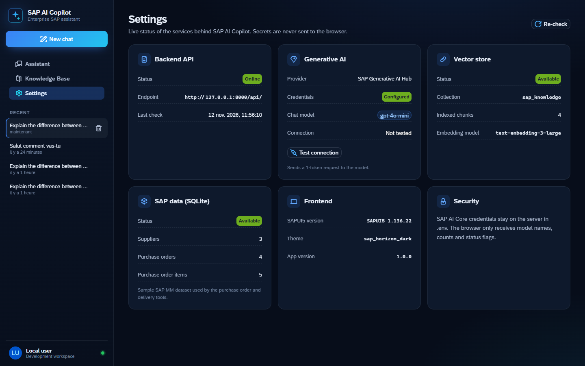

# SAP AI Copilot

Assistant IA pour SAP MM, SD, FI et le développement ABAP, construit sur **SAP Generative AI Hub** (SAP AI Core). Il combine un agent à **Tool Calling** qui interroge les commandes d'achat, les commandes clients et les factures fournisseurs d'un système **SAP S/4HANA Cloud via OData**, un pipeline **RAG** sur une documentation technique SAP et une interface **SAPUI5** inspirée de SAP Fiori.

L'application fonctionne en local et se déploie sur **SAP BTP (Cloud Foundry)** derrière l'**Application Router**, avec connexion SAP (XSUAA).



## Fonctionnalités

### Agent IA

- GPT-4o-mini via SAP Generative AI Hub (SDK `sap-ai-sdk-gen`)
- Tool Calling avec onze outils :
  - **Achats (MM)** : consultation d'une commande d'achat (postes, échéances, quantités ouvertes), analyse des retards de livraison, recherche par fournisseur ou par date
  - **Ventes (SD)** : consultation d'une commande client (client, statuts, postes, dates confirmées), recherche par client ou par date, commandes clients en retard de livraison
  - **Finance (FI)** : consultation d'une facture fournisseur (montants, conditions de paiement, blocage de paiement, postes facturés), recherche par fournisseur, par date ou des factures bloquées au paiement, **rapprochement à trois** d'une commande d'achat (commandé / reçu / facturé, poste par poste, avec écarts de quantité et de prix et solde GR/IR)
  - **Documentation** : recherche RAG dans la documentation du module (MM, SD, FI ou ABAP)
  - **Documents joints** : lecture des documents ajoutés à la conversation, partie par partie
- **Documents joints** : bouton **+** dans la zone de saisie pour joindre des PDF, Word (`.docx`), Excel (`.xlsx`), fichiers texte (`.txt`, `.md`, `.csv`, `.json`, `.xml`…) et **images** (`.png`, `.jpg`, `.webp`, `.gif`, `.bmp`, `.tif`), 10 Mo par fichier. Les images (capture d'écran SAP, photo de facture) et les pages scannées des PDF sont lues par la vision du modèle (`app/attachments/vision.py`), une seule fois à l'envoi : la transcription, signalée comme telle à l'utilisateur et à l'agent, est conservée, jamais l'image ; 20 pages scannées au plus par PDF. L'agent les lit, les résume et les croise avec les données SAP (par exemple une facture PDF comparée au rapprochement à trois de la commande qu'elle cite). Seul le texte extrait est conservé, avec la conversation ; le contenu d'un document est traité comme une donnée, jamais comme une instruction
- Données transactionnelles lues dans **SAP S/4HANA Cloud** via les API officielles `API_PURCHASEORDER_2` et `API_SALESORDER` (OData V4), `API_SUPPLIERINVOICE_PROCESS_SRV`, `API_MATERIAL_DOCUMENT_SRV` et `API_BUSINESS_PARTNER` (OData V2), ou dans une base SQLite de démonstration (achats uniquement) utilisable hors ligne
- **Espaces de travail par module** (MM, SD, FI, ABAP) : l'agent n'utilise que les outils et la documentation du module choisi
- RAG sur le **SAP HANA Cloud Vector Engine** (`REAL_VECTOR`, similarité cosinus) sur SAP BTP, sur ChromaDB en local, avec les embeddings `text-embedding-3-large` de SAP Generative AI Hub
- **Base de connaissances enrichissable depuis l'interface** : ajout d'un PDF (même scanné), Word, Excel, fichier texte ou image pour un espace de travail (MM, SD, FI, ABAP) ou pour tous, depuis la page Knowledge Base ou depuis un document joint dans une conversation ; l'agent du module le consulte aussitôt. Les documents livrés (`data/documents`) sont indexés au démarrage du backend, et seulement s'ils ont changé
- Réponses fondées sur les données et les documents récupérés, avec citation des sources

### Interface SAPUI5

- Réponses en streaming : l'outil en cours d'exécution s'affiche en direct (« Reading purchase order data », « Searching the knowledge base »), puis le texte apparaît progressivement. Un bouton **Stop** interrompt la génération sans rien enregistrer
- Chat : envoi avec Entrée, retour à la ligne avec Shift + Entrée, indicateur de génération, rendu Markdown, copie des réponses et bouton « Copier » sur chaque bloc de code (CDS views, ABAP, commandes…), gestion des erreurs avec bouton « Réessayer »
- **Avis sur les réponses** : 👍 / 👎 sous chaque réponse, avec un commentaire facultatif après un 👎 (« What was wrong? »), enregistrés dans l'historique (SAP HANA Cloud sur BTP). La page **Feedback** affiche le taux de satisfaction et les derniers avis, filtrables ; un avis peut être copié comme **cas d'évaluation** (`Case(...)` à coller dans `evals/agent_eval.py`) pour qu'une mauvaise réponse ne revienne pas. Chacun voit ses propres avis ; les utilisateurs ayant la collection de rôles **SAP AI Copilot Feedback Reviewer** (créée par `deploy.ps1`, à attribuer dans le cockpit BTP : *Security > Users*) voient ceux de tous les utilisateurs. Un avis est supprimé avec sa conversation
- **Export d'une conversation** (bouton de téléchargement en haut du chat) : fichier **Markdown** (`.md`) pour un ticket, un wiki ou un mail, ou **PDF** via la boîte d'impression du navigateur (« Enregistrer au format PDF »), mise en page claire. Questions, réponses, tableaux de données SAP avec leurs valeurs formatées, outils utilisés, sources et documents joints ; construit dans le navigateur (`util/ConversationExport.js`), sans bibliothèque ni appel au serveur
- Sources RAG affichées sous chaque réponse, avec l'extrait réellement récupéré dans la base vectorielle et sa distance
- Outils utilisés par l'agent affichés pour chaque réponse
- **Tableaux Fiori** sous la réponse pour les données SAP (commandes d'achat, commandes clients, factures fournisseurs et rapprochement à trois) : en-tête du document, postes, montants, dates, statuts colorés, jours de retard, blocages de paiement. Les tableaux sont construits par le backend à partir des résultats des outils, jamais à partir du texte du modèle. Un clic sur une ligne d'une liste ouvre l'analyse du document. Les colonnes secondaires sont masquées quand la place manque
- **Export Excel** de chaque tableau (bouton dans son en-tête) : toutes les colonnes, y compris celles masquées à l'écran, avec des cellules typées (dates, nombres, montants dans leur devise, quantités et unités) et une feuille *Information* (système SAP, période, totaux, en-tête du document, date d'export). Le fichier `.xlsx` est généré dans le navigateur (`sap.ui.export`) et contient les lignes affichées
- Page **Modules** : un espace de travail par module SAP, avec un statut réel (connecté, documentation, prévu), ses outils, sa documentation et ses suggestions
- Historique persistant : nouvelle conversation, liste, reprise, renommage, suppression. Chaque conversation garde son module. Le contexte de l'agent est restauré après un redémarrage du backend. Stocké dans **SAP HANA Cloud** sur SAP BTP, dans SQLite en local
- Page **Knowledge Base** : documents livrés et ajoutés, espace de travail, nombre de chunks indexés et attendus, statut d'indexation, moteur vectoriel ; ajout et suppression de documents (par leur auteur)
- Page **Settings** : statut en direct du backend, de l'IA (avec test de connexion), de la base vectorielle et des données SAP
- Thème sombre bleu nuit basé sur `sap_horizon_dark`, responsive desktop et tablette

### Déploiement SAP BTP

- Application Router : connexion SAP obligatoire (XSUAA), hébergement de l'application SAPUI5, relais de `/api` vers le backend
- Backend protégé par jeton : chaque appel à l'API exige un jeton XSUAA valide, vérifié avec la librairie officielle `sap-xssec`
- Profil de l'utilisateur SAP connecté affiché dans la barre latérale
- Script de déploiement idempotent et script de suppression, sans secret dans le code

| Accueil | Sources RAG |
| --- | --- |
|  |  |

| Knowledge Base | Settings |
| --- | --- |
|  |  |

## Architecture

```text
Frontend SAPUI5
        │  HTTP / REST (JSON), chemin relatif /api
        ▼
Local : proxy de ui5 serve (port 8080)   │   SAP BTP : Application Router + XSUAA
        │                                            │  jeton de l'utilisateur transmis
        ▼                                            ▼
Backend FastAPI (local : port 8000 ; BTP : jeton XSUAA exigé)
        │
        ▼
Agent SAP (Tool Calling)
        ├── SAP Generative AI Hub ── GPT-4o-mini, text-embedding-3-large
        ├── get_purchase_order       ─┐
        ├── get_overdue_orders        ├── Source de données SAP (SAP_DATA_SOURCE)
        ├── search_purchase_orders   ─┘     ├── odata  : SAP S/4HANA Cloud, API_PURCHASEORDER_2 (OData V4)
        │                                   └── sqlite : base de démonstration locale
        ├── get_sales_order, search_sales_orders, get_late_sales_orders
        │                            ── SAP S/4HANA Cloud, API_SALESORDER (OData V4)
        ├── get_supplier_invoice, search_supplier_invoices, match_purchase_order_invoices
        │                            ── SAP S/4HANA Cloud, API_SUPPLIERINVOICE_PROCESS_SRV,
        │                               API_MATERIAL_DOCUMENT_SRV, API_BUSINESS_PARTNER (OData V2)
        └── search_sap_documentation ── RAG : HANA Cloud Vector Engine (BTP) / ChromaDB (local)
```

```text
SAP_AI_Copilot/
├── app/
│   ├── api.py              # API FastAPI
│   ├── auth.py             # Validation du jeton XSUAA (actif sur BTP uniquement)
│   ├── cloud_env.py        # Lecture des services liés Cloud Foundry (VCAP_SERVICES)
│   ├── system_info.py      # Statut des services et inventaire de la Knowledge Base
│   ├── agent/agent.py      # Agent à Tool Calling
│   ├── agent/data_tables.py # Tableaux de données SAP construits à partir des résultats des outils
│   ├── llm/                # Client SAP Generative AI Hub
│   ├── tools/              # Outils appelés par l'agent
│   ├── sap_data/           # Sources de données SAP : client OData S/4HANA (achats, ventes, factures), SQLite
│   ├── rag/                # Base de connaissances : découpage, embeddings, recherche (HANA Vector Engine ou ChromaDB)
│   ├── attachments/        # Documents joints : extraction du texte (PDF, Word, Excel, texte), lecture des images et scans par le modèle, lecture par l'agent
│   ├── database/           # Schéma et jeu de données SQLite
│   └── storage/            # Historique des conversations et documents joints (SQLite en local, SAP HANA Cloud sur BTP)
├── data/documents/         # Documentation indexée par le RAG
├── tests/                  # Tests pytest (rapprochement à trois, tableaux, connexion SAP)
├── evals/                  # Évaluation de l'agent avec le vrai modèle
├── deploy/
│   ├── approuter/          # Application Router (package.json, xs-app.json)
│   ├── manifest.yml        # Applications Cloud Foundry
│   ├── xs-security.json    # Configuration XSUAA
│   ├── deploy.ps1          # Build et déploiement sur SAP BTP
│   └── cleanup.ps1         # Suppression des ressources déployées
├── frontend/
│   ├── ui5.yaml            # UI5 Tooling (SAPUI5 1.136 LTS) + proxy /api local
│   ├── lib/apiProxy.js     # Proxy de développement vers le backend
│   └── webapp/
│       ├── controller/     # App, Chat, KnowledgeBase, Settings
│       ├── view/           # Vues XML
│       ├── service/        # Client REST centralisé
│       ├── util/           # Rendu Markdown sécurisé, tableaux de données SAP et export Excel
│       ├── css/            # Thème
│       └── i18n/           # Textes
└── requirements.txt
```

## API

| Méthode | Endpoint | Description |
| --- | --- | --- |
| `GET` | `/api/health` | Disponibilité du backend |
| `POST` | `/api/chat` | Envoie un message. Renvoie `session_id`, `response`, `sources`, `tools_used` et `tables` |
| `POST` | `/api/chat/stream` | Même requête, réponse en flux NDJSON : `session`, `tool_start`, `tool_end`, `token`, `done` (avec `tables`), `error` |
| `GET` | `/api/sessions` | Liste des conversations |
| `GET` | `/api/sessions/{id}` | Messages d'une conversation |
| `DELETE` | `/api/sessions/{id}` | Supprime une conversation (et ses documents joints et avis) |
| `PUT` / `DELETE` | `/api/sessions/{id}/messages/{message_id}/feedback` | Avis sur une réponse (`rating` 1 ou -1, `comment` facultatif) / suppression |
| `GET` | `/api/feedback?rating=` | Statistiques et derniers avis (de tous les utilisateurs pour un relecteur) |
| `POST` | `/api/sessions/{id}/attachments` | Joint un document (multipart, champ `file`) ; la conversation peut ne pas encore exister. Renvoie l'`id`, le nom, le nombre de pages et de caractères |
| `GET` | `/api/sessions/{id}/attachments` | Documents joints à une conversation |
| `DELETE` | `/api/sessions/{id}/attachments/{attachment_id}` | Retire un document joint |
| `GET` | `/api/knowledge-base` | Documents, espace de travail, chunks indexés, statut et moteur vectoriel |
| `POST` | `/api/knowledge-base/documents` | Ajoute un document à la base de connaissances (multipart : `file`, `module` vide = tous les espaces) |
| `POST` | `/api/knowledge-base/documents/from-attachment` | Ajoute un document joint d'une conversation de l'utilisateur (`session_id`, `attachment_id`, `module`) |
| `DELETE` | `/api/knowledge-base/documents/{name}` | Retire un document ajouté (par son auteur uniquement) |
| `GET` | `/api/status?check_ai=true` | Statut du backend, de l'IA, de la base vectorielle, de l'historique et des données SAP |

Exemple :

```json
POST /api/chat
{ "message": "Explique la différence entre EKKO et EKPO", "session_id": null }
```

```json
{
  "session_id": "6ad50f57-…",
  "response": "EKKO contient l'en-tête de la commande d'achat…",
  "sources": [{ "source": "sap_mm.txt", "chunk": 0, "distance": 0.977, "content": "…" }],
  "tools_used": ["search_sap_documentation"]
}
```

Exemple de flux renvoyé par `/api/chat/stream` (une ligne JSON par événement) :

```text
{"type": "session", "session_id": "0782671e-…"}
{"type": "tool_start", "name": "get_purchase_order"}
{"type": "tool_end", "name": "get_purchase_order", "success": true}
{"type": "token", "content": "Purchase order"}
{"type": "done", "session_id": "0782671e-…", "response": "…", "sources": [], "tools_used": ["get_purchase_order"]}
```

> SAP Generative AI Hub renvoie le premier token puis le reste du texte d'un seul bloc (mise en mémoire tampon côté SAP AI Core). Le frontend affiche donc ce texte reçu de façon progressive. Les événements d'outils, eux, arrivent bien en temps réel.

La documentation interactive de l'API est disponible sur `http://127.0.0.1:8000/docs`.

## Connexion à SAP S/4HANA Cloud

Les outils transactionnels lisent les commandes d'achat via l'API officielle **Purchase Order (OData V4)**, service `API_PURCHASEORDER_2`, en lecture seule. Par défaut, ils interrogent le **sandbox du SAP Business Accelerator Hub** : un système S/4HANA Cloud de démonstration avec plus de 200 000 commandes.

| Besoin | Entité OData |
| --- | --- |
| En-tête de commande | `PurchaseOrder` |
| Nom du fournisseur | `_SupplierAddress/OrganizationName1` |
| Postes (article, quantité, prix) | `_PurchaseOrderItem` |
| Dates de livraison et quantités ouvertes | `_PurchaseOrderScheduleLineTP` / `PurchaseOrderScheduleLine` |

Les factures fournisseurs (module FI) sont lues via l'API **Supplier Invoice** (`API_SUPPLIERINVOICE_PROCESS_SRV`, OData V2), avec la même clé : en-tête (`A_SupplierInvoice`) et postes rattachés aux commandes d'achat (`A_SuplrInvcItemPurOrdRef`). Les noms des fournisseurs viennent de `API_BUSINESS_PARTNER` (`A_Supplier`). Le **rapprochement à trois** compare, pour chaque poste d'une commande d'achat, la quantité commandée et le prix net (`API_PURCHASEORDER_2`), la quantité reçue (entrées de marchandises de `API_MATERIAL_DOCUMENT_SRV`, retours et annulations déduits selon le code débit/crédit) et la quantité et le montant facturés (avoirs déduits, factures annulées et leurs documents d'annulation ignorés). Un écart de prix est signalé au-delà de 0,5 % du montant attendu.

Les commandes clients (module SD) sont lues via l'API **Sales Order (OData V4)**, service `API_SALESORDER`, avec la même clé : en-tête (`SalesOrder`), client (`_Partner`, fonction partenaire `AG`), postes (`_Item`) et échéances (`_ScheduleLine`). Une commande client est **en retard** lorsque sa date de livraison demandée est dépassée et qu'elle n'est pas entièrement livrée (`OverallDeliveryStatus` A ou B). L'API ne permettant pas de filtrer sur le nom du client, ce nom est d'abord résolu en numéro de client à partir des commandes récentes.

Une commande d'achat est considérée **en retard** lorsqu'une échéance a une date de livraison dépassée et une quantité encore ouverte (`OpenPurchaseOrderQuantity > 0`). OData V4 impose de filtrer une quantité avec son unité : les unités contrôlées sont configurables (`SAP_QUANTITY_UNITS`, par défaut `PC,EA`). Sur un système de cette taille, l'analyse porte sur une fenêtre de temps récente, et l'agent indique toujours la fenêtre et les totaux.

### Configuration

1. Se connecter sur [api.sap.com](https://api.sap.com), ouvrir l'API [Purchase Order (OData V4)](https://api.sap.com/api/CE_PURCHASEORDER_0001/overview) et cliquer sur **Show API Key**.
2. Dans `.env` :

```env
SAP_DATA_SOURCE=odata
SAP_API_KEY=<votre clé>
```

Avec `SAP_DATA_SOURCE=sqlite` (valeur par défaut), l'application utilise la base de démonstration locale et fonctionne sans réseau. `SAP_API_BASE_URL` permet de viser un autre système S/4HANA Cloud qui expose les mêmes API.

Sur SAP BTP, le système S/4HANA est lu dans une **destination** du Destination service (`SAP_DESTINATION_NAME`), pas dans une clé en variable d'environnement : voir [Connexion S/4HANA par destination](#connexion-s4hana-par-destination).

## Installation

### Prérequis

- Python 3.12
- Node.js 20.11 ou plus récent
- Un accès à SAP AI Core avec des déploiements `gpt-4o-mini` et `text-embedding-3-large` dans SAP Generative AI Hub

### Backend

```powershell
python -m venv .venv
.\.venv\Scripts\Activate.ps1
pip install -r requirements.txt

# Identifiants SAP AI Core : copier le modèle puis le compléter
Copy-Item .env.example .env

# Données SAP MM fictives (SQLite), utilisées si SAP_DATA_SOURCE=sqlite
python -m app.database.seed

# Indexation de la documentation livrée (facultatif : le backend la fait au démarrage)
python -m app.rag.index_documents

uvicorn app.api:app --reload --port 8000
```

### Frontend

```powershell
cd frontend
npm install
npm start
```

L'application s'ouvre sur `http://localhost:8080/index.html`. Le serveur de développement relaie `/api` vers `http://127.0.0.1:8000` (modifiable avec la variable `API_PROXY_TARGET`), comme l'Application Router le fait sur SAP BTP.

> Sous Windows, si PowerShell bloque `npm` (politique d'exécution), utiliser `npm.cmd`.

### Commandes utiles

| Commande | Rôle |
| --- | --- |
| `npm start` | Serveur de développement UI5 sur le port 8080 |
| `npm run lint` | Analyse du code SAPUI5 (UI5 linter) |
| `npm run build` | Build de production dans `frontend/dist` |
| `python -m app.main` | Version en ligne de commande de l'agent |
| `python -m pytest` | Tests automatisés du backend (depuis la racine du projet) |
| `python -m evals.agent_eval` | Évaluation de la qualité de l'agent avec le vrai modèle (voir ci-dessous) |

### Tests

`python -m pytest` lance les tests du backend. Ils simulent toutes les réponses externes (S/4HANA, Destination service) : ils tournent hors ligne, sans clé ni identifiants, en moins d'une seconde. Ils couvrent :

- le **rapprochement à trois** : chaque statut, retours et annulations d'entrées, avoirs, factures annulées, débits ultérieurs, tolérance de prix, solde GR/IR, numéros de poste au format différent selon l'API ;
- les **avis** : identifiant de la réponse renvoyé par le chat, avis enregistré, modifié, supprimé, visible dans l'historique, refusé sur la réponse d'un autre utilisateur ou sur une question, statistiques et filtre, périmètre utilisateur / relecteur, secrets masqués dans un commentaire, suppression avec la conversation ;
- l'**historique** : conversations, messages, documents joints, textes longs et unicode, **isolation entre utilisateurs** (lecture, modification, suppression, envoi de messages et de documents dans la conversation d'un autre), migration des anciens fichiers SQLite et des tables HANA, démarrage sans base disponible. Les mêmes tests tournent sur SAP HANA Cloud quand `HANA_TEST_KEY_FILE` désigne la clé d'un service `hana` (`cf service-key …`) ;
- le **déploiement** : le backend démarre sans ChromaDB (comme sur BTP) et utilise le HANA Vector Engine ;
- l'**identité** : utilisateur tiré du jeton validé uniquement (un en-tête envoyé par le navigateur est ignoré), refus sans jeton ;
- le **masquage des données sensibles** : colonnes de secrets (CSV, Excel), paires « password: … », clés privées, jetons, cartes (Luhn) et IBAN (mod 97), aucune modification de la documentation SAP ni des numéros SAP, stockage masqué des documents joints et de la base de connaissances, documents enregistrés avant la protection ;
- la **base de connaissances** : synchronisation des documents livrés (nouveau, inchangé, modifié, supprimé), recherche limitée aux documents d'un espace, ajout, doublons, suppression par l'auteur seulement, échec d'embedding sans trace, ajout depuis un document joint et API. Les mêmes tests tournent sur le SAP HANA Cloud Vector Engine avec `HANA_TEST_KEY_FILE` ;
- la **lecture des images et des PDF scannés** (modèle simulé) : formats convertis (TIFF fax, BMP, GIF, WebP), grandes images réduites, images vides ou illisibles refusées, transcription page par page avec limite, pages texte jamais envoyées au modèle, erreur claire si le modèle est indisponible, masquage de la transcription ;
- les **documents joints** : extraction PDF / Word / Excel / texte, fichiers refusés (type, taille, archive piégée), lecture par parties, cloisonnement entre conversations, API d'envoi et de suppression ;
- les **tableaux de données** : colonnes sans valeur retirées, limite de lignes, unités de total, actions sur les lignes, dédoublonnage ;
- la **connexion SAP** : mode direct, lecture de la destination (en-têtes d'authentification, `URL.headers.*`, `URL.queries.*`, cache et expiration des jetons, erreurs) et construction des requêtes OData.

### Évaluation de l'agent

`python -m evals.agent_eval` pose une vingtaine de questions de référence au **vrai modèle** (SAP Generative AI Hub) et vérifie, pour chacune, les outils que l'agent doit appeler, ceux qu'il ne doit pas appeler et des mots attendus dans la réponse : choix de l'outil SAP, recherche dans la base de connaissances (y compris les documents ajoutés), respect du périmètre de chaque espace de travail, lecture des documents joints et résistance aux instructions cachées dans un document.

Les outils SAP, la base de connaissances et les documents joints sont remplacés par des réponses préparées : aucun système SAP n'est appelé et seul le comportement du modèle est évalué. Options : `-k <texte>` pour ne lancer que certains cas, `--repeat N` pour répéter chaque cas (le modèle n'est pas totalement déterministe), `--json <fichier>` pour le détail. Une exécution prend une vingtaine de secondes et consomme quelques tokens ; elle ne fait pas partie de `python -m pytest`. À lancer après chaque modification du prompt, des descriptions d'outils ou des consignes des modules.

## Déploiement sur SAP BTP

```text
Navigateur
   │  HTTPS
   ▼
sap-ai-copilot-approuter   (Node.js, Application Router)
   │  connexion SAP via XSUAA, sert l'application SAPUI5 (SAPUI5 chargé depuis le CDN SAP)
   │  /api/*  ─►  jeton de l'utilisateur transmis (forwardAuthToken)
   ▼
sap-ai-copilot-backend     (Python, FastAPI)
   │  refuse tout appel sans jeton XSUAA valide (401), sauf /api/health
   ├── sap-ai-copilot-aicore  ─►  SAP Generative AI Hub
   ├── sap-ai-copilot-destination ─►  destination ─►  SAP S/4HANA Cloud (OData V2 et V4)
   ├── sap-ai-copilot-hana    ─►  schéma SAP HANA Cloud : historique et documents joints
   └── (sap-ai-copilot-hana)  ─►  SAP HANA Cloud Vector Engine : base de connaissances du RAG
```

| Ressource Cloud Foundry | Type | Rôle |
| --- | --- | --- |
| `sap-ai-copilot-approuter` | Application Node.js, 256 Mo | Connexion, interface SAPUI5, relais `/api` |
| `sap-ai-copilot-backend` | Application Python, 1 Go | API FastAPI, agent, RAG |
| `sap-ai-copilot-xsuaa` | Service `xsuaa` / `application` | Authentification des utilisateurs |
| `sap-ai-copilot-aicore` | Service user-provided | Identifiants SAP AI Core |
| `sap-ai-copilot-destination` | Service `destination` / `lite` (gratuit) | Connexion au système S/4HANA |
| `sap-ai-copilot-hana` | Service `hana` / `schema` (gratuit) | Schéma dans la base SAP HANA Cloud du sous-compte : historique des conversations et documents joints |

### Prérequis BTP

- Un sous-compte SAP BTP avec l'environnement Cloud Foundry, un space et le rôle **Space Developer**
- Les services **xsuaa** (plan `application`) et **destination** (plan `lite`) disponibles dans le sous-compte
- La CLI Cloud Foundry v8 (`winget install CloudFoundry.CLI.v8`)
- Un `.env` complet (identifiants AI Core et clé S/4HANA). Aucun index RAG à construire : le backend indexe la documentation dans SAP HANA Cloud à son démarrage

### Déployer

```powershell
cf login -a https://api.cf.<région>.hana.ondemand.com --sso
.\deploy\deploy.ps1
```

Le script :

1. construit le dossier `deploy/build` (non versionné) : code du backend sans les tests, documentation livrée, dépendances Python figées sur les versions testées en local (sans ChromaDB ni pytest, inutiles sur BTP : le déploiement est bien plus rapide), build SAPUI5 ;
2. crée ou met à jour les trois services, dont la destination S/4HANA. Les secrets sont lus dans `.env` et transmis à Cloud Foundry par des fichiers temporaires, jamais en ligne de commande ;
3. déploie le backend puis l'Application Router ;
4. vérifie la sécurité : le backend doit répondre **401** à un appel sans jeton, sinon le script échoue ;
5. affiche l'URL de l'application.

Le script peut être relancé pour publier une nouvelle version. Il ne crée ou ne modifie que les ressources dont le nom commence par `sap-ai-copilot-`.

### Connexion S/4HANA par destination

Le backend lit le système S/4HANA (URL et authentification) auprès du **Destination service** de SAP BTP, avec la destination nommée par `SAP_DESTINATION_NAME`. C'est le Destination service qui gère l'authentification : il renvoie des en-têtes prêts à l'emploi pour `BasicAuthentication`, `OAuth2ClientCredentials`, `OAuth2SAMLBearerAssertion`, etc. Les propriétés additionnelles `URL.headers.<nom>` et `URL.queries.<nom>` sont ajoutées à chaque appel.

- **Par défaut** (sandbox) : `deploy.ps1` crée une destination d'instance `sap-ai-copilot-s4` vers `SAP_API_BASE_URL` (le sandbox par défaut), avec la clé `SAP_API_KEY` en propriété `URL.headers.APIKey`.
- **Autre système S/4HANA** : créer une destination HTTP au niveau du sous-compte (cockpit BTP > Connectivity > Destinations, type `Internet`), puis ajouter `BTP_S4_DESTINATION=<nom>` dans `.env` et relancer `deploy.ps1`. `SAP_API_KEY` n'est alors plus nécessaire. Aucune modification de code n'est nécessaire.

La destination est relue toutes les 5 minutes au plus (moins si un jeton OAuth expire plus tôt), et immédiatement après une erreur 401 ou 403. Les destinations `OnPremise` (Cloud Connector) ne sont pas prises en charge. La page **Settings** indique le mode de connexion utilisé.

En local, l'application se connecte directement avec `SAP_API_BASE_URL` et `SAP_API_KEY`.

### Vérifier

- `cf apps` : les deux applications sont `started`, avec 1/1 instance
- L'URL de l'application demande une connexion SAP, puis affiche le nom de l'utilisateur dans la barre latérale
- La page **Settings** indique un backend en ligne, une IA joignable et la source de données S/4HANA
- En cas de problème : `cf logs sap-ai-copilot-backend --recent`

### Supprimer

```powershell
.\deploy\cleanup.ps1
```

Supprime les deux applications (avec leurs routes) et les services `sap-ai-copilot-*`, par leur nom exact, après confirmation.

### Points d'attention

- **Historique des conversations et documents joints** : stockés dans un schéma SAP HANA Cloud (`hana` / `schema`, gratuit) créé par `deploy.ps1` dans la base HANA Cloud existante du sous-compte. Ils survivent aux redémarrages et aux déploiements. Le schéma dépend de cette base : si elle est arrêtée (sandbox arrêtée la nuit, par exemple), le backend démarre quand même, répond aux questions sans l'historique et l'API d'historique renvoie 503 ; tout reprend dès que la base redémarre. La page **Settings** indique l'état de l'historique. `cleanup.ps1` supprime aussi ce schéma, donc tout l'historique.
- **Secrets** : les identifiants SAP AI Core sont dans un service user-provided, lisible par les membres du space ayant le rôle Space Developer (`cf env`). Une liaison directe à une instance SAP AI Core est l'alternative à privilégier en production. La connexion S/4HANA passe déjà par le Destination service.
- **Région** : le domaine `cfapps.eu10-005.hana.ondemand.com` est indiqué dans `deploy/manifest.yml` et `deploy/xs-security.json`. Il faut l'adapter pour une autre région.
- **Pourquoi un jeton plutôt qu'une route interne** : rendre le backend accessible uniquement depuis l'Application Router via une règle réseau demande le droit `network.write`, rarement accordé aux développeurs. La validation du jeton XSUAA protège l'API de la même façon, sans droit particulier.

## Sécurité

- Les identifiants SAP AI Core et la clé API S/4HANA restent côté serveur : dans `.env` en local (exclu du dépôt). Sur BTP, ils sont dans un service Cloud Foundry pour AI Core et dans une destination BTP pour S/4HANA.
- Sur BTP, toute l'application exige une connexion SAP (XSUAA) et l'API vérifie le jeton de chaque appel.
- **Historique par utilisateur** : chaque conversation et chaque document joint appartient à l'utilisateur connecté, identifié par le jeton XSUAA validé (fournisseur d'identité + nom de connexion), jamais par une information envoyée par le navigateur. Un utilisateur ne voit, ne reprend, ne renomme et ne supprime que ses conversations ; l'agent ne lit que ses documents. Une conversation d'un autre utilisateur répond comme une conversation inexistante (404). En local, sans connexion SAP, l'historique appartient à l'utilisateur `local`.
- Les requêtes qui modifient des données (`POST`, `PUT`, `DELETE`) sont protégées par un jeton CSRF via l'Application Router.
- **Images et pages scannées** : elles sont envoyées une fois au modèle de SAP Generative AI Hub pour être transcrites (comme le texte des questions) ; seule la transcription est stockée, après masquage des données sensibles.
- **Données sensibles masquées** avant tout stockage et tout envoi au modèle (`app/attachments/sensitive.py`) : mots de passe, secrets, clés d'API, jetons, clés privées et numéros de carte (somme de contrôle Luhn) dans les documents joints comme dans la base de connaissances ; les IBAN (somme de contrôle ISO 13616) aussi dans la base de connaissances, partagée. Dans un CSV ou un classeur Excel, toute la colonne dont l'en-tête nomme un secret (« PASSWORD », « Mot de passe », « api_key »…) est masquée. La valeur est remplacée par « [masked …] » et n'est conservée nulle part ; l'utilisateur voit ce qui a été masqué et l'agent répond qu'une valeur est masquée au lieu de l'inventer. Les documents enregistrés avant cette protection sont vérifiés une fois au démarrage du backend.
- L'accès à S/4HANA est en lecture seule (requêtes GET uniquement).
- Le navigateur ne reçoit que des noms de modèles, des compteurs et des indicateurs de statut.
- Les réponses du modèle sont échappées avant le rendu Markdown, puis nettoyées par le sanitizer HTML de SAPUI5.

## Données

- **Mode `odata`** : les données viennent du sandbox SAP S/4HANA Cloud, un système de démonstration fourni par SAP. Elles sont fictives côté entreprise mais produites par un vrai système S/4HANA.
- **Mode `sqlite`** : les commandes d'achat, fournisseurs et articles sont **fictifs**, générés par `app/database/seed.py`.

Les documents de `data/documents` servent de base documentaire au RAG.

## Pistes d'évolution


## Stack technique

SAPUI5 1.136 · UI5 Tooling 4 · FastAPI · SAP Generative AI Hub · SAP AI SDK · SAP S/4HANA Cloud OData V2 et V4 · SAP BTP Cloud Foundry · Application Router · XSUAA · Destination service · SAP HANA Cloud (Vector Engine) · ChromaDB · SQLite · Python 3.12
