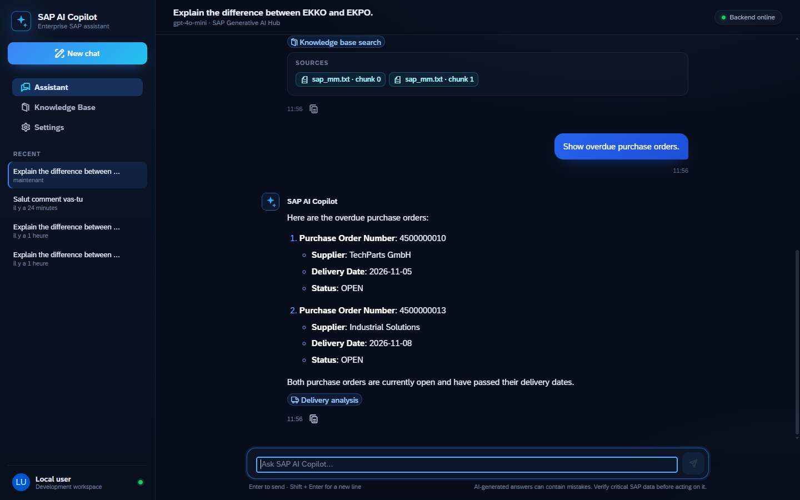
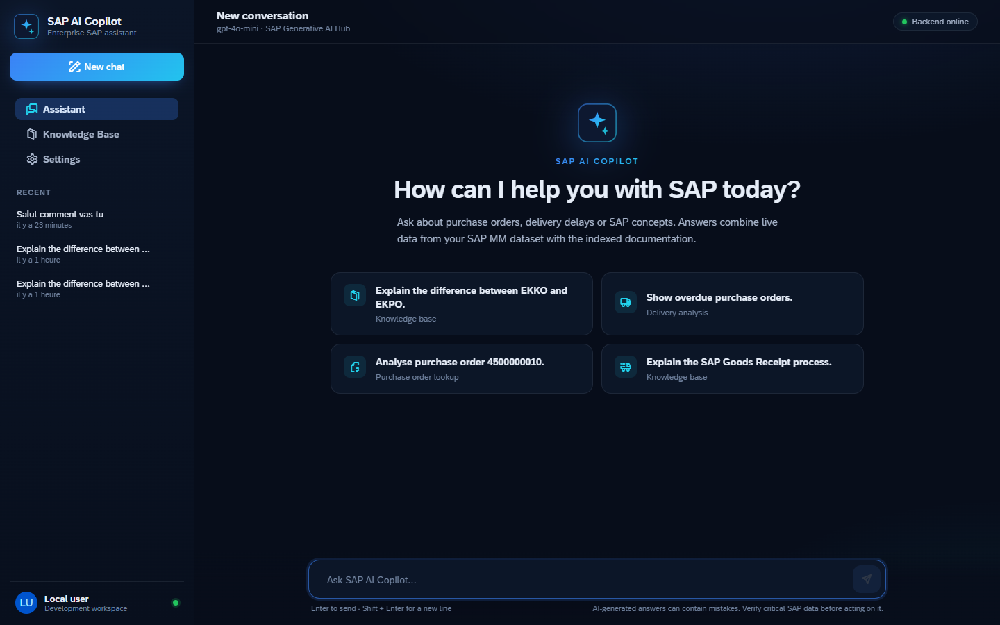
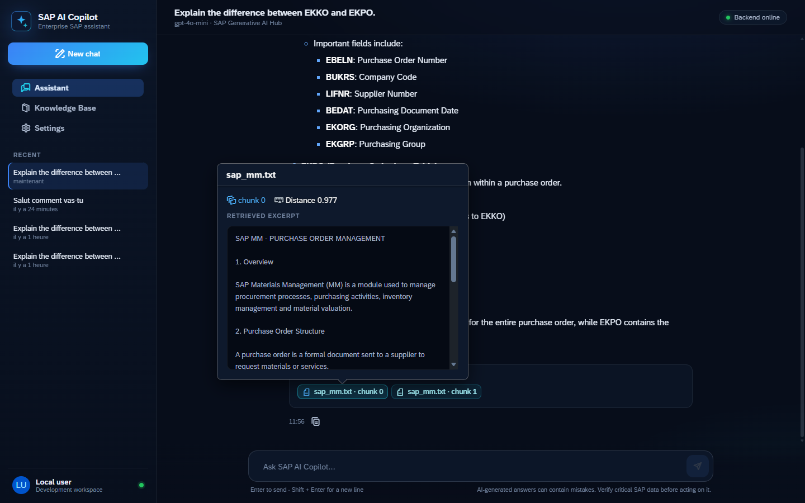
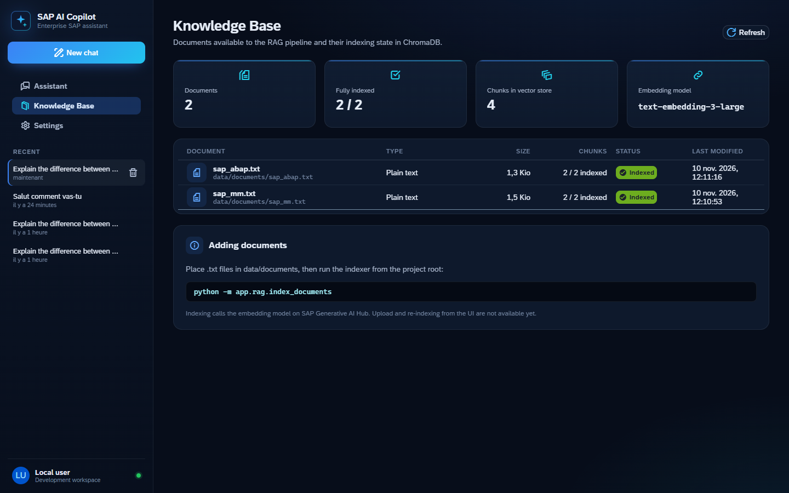
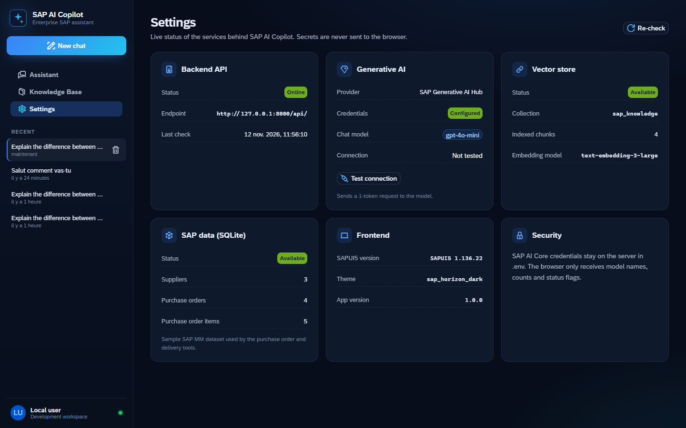

# SAP AI Copilot

Assistant IA pour SAP MM et le développement ABAP, construit sur **SAP Generative AI Hub** (SAP AI Core). Il combine un agent à **Tool Calling** qui interroge les commandes d'achat d'un système **SAP S/4HANA Cloud via OData V4**, un pipeline **RAG** sur une documentation technique SAP et une interface **SAPUI5** inspirée de SAP Fiori.



## Fonctionnalités

### Agent IA

- GPT-4o-mini via SAP Generative AI Hub (SDK `sap-ai-sdk-gen`)
- Tool Calling avec quatre outils : consultation d'une commande d'achat (postes, échéances, quantités ouvertes), analyse des retards de livraison, recherche de commandes par fournisseur ou par date, recherche dans la documentation
- Données transactionnelles lues dans **SAP S/4HANA Cloud** via l'API officielle `API_PURCHASEORDER_2` (OData V4), ou dans une base SQLite de démonstration utilisable hors ligne
- RAG sur ChromaDB avec les embeddings `text-embedding-3-large`
- Réponses fondées sur les données et les documents récupérés, avec citation des sources

### Interface SAPUI5

- Réponses en streaming : l'outil en cours d'exécution s'affiche en direct (« Reading purchase order data », « Searching the knowledge base »), puis le texte apparaît progressivement. Un bouton **Stop** interrompt la génération sans rien enregistrer
- Chat : envoi avec Entrée, retour à la ligne avec Shift + Entrée, indicateur de génération, rendu Markdown, copie des réponses, gestion des erreurs avec bouton « Réessayer »
- Sources RAG affichées sous chaque réponse, avec l'extrait réellement récupéré dans ChromaDB et sa distance vectorielle
- Outils utilisés par l'agent affichés pour chaque réponse
- Historique persistant : nouvelle conversation, liste, reprise, suppression. Le contexte de l'agent est restauré après un redémarrage du backend
- Page **Knowledge Base** : documents indexés, nombre de chunks indexés et attendus, statut d'indexation
- Page **Settings** : statut en direct du backend, de l'IA (avec test de connexion), de la base vectorielle et des données SAP
- Thème sombre bleu nuit basé sur `sap_horizon_dark`, responsive desktop et tablette

| Accueil | Sources RAG |
| --- | --- |
|  |  |

| Knowledge Base | Settings |
| --- | --- |
|  |  |

## Architecture

```text
Frontend SAPUI5 (UI5 Tooling, port 8080)
        │  HTTP / REST (JSON)
        ▼
Backend FastAPI (port 8000)
        │
        ▼
Agent SAP (Tool Calling)
        ├── SAP Generative AI Hub ── GPT-4o-mini, text-embedding-3-large
        ├── get_purchase_order       ─┐
        ├── get_overdue_orders        ├── Source de données SAP (SAP_DATA_SOURCE)
        ├── search_purchase_orders   ─┘     ├── odata  : SAP S/4HANA Cloud, API_PURCHASEORDER_2 (OData V4)
        │                                   └── sqlite : base de démonstration locale
        └── search_sap_documentation ── RAG / ChromaDB
```

```text
SAP_AI_Copilot/
├── app/
│   ├── api.py              # API FastAPI
│   ├── system_info.py      # Statut des services et inventaire de la Knowledge Base
│   ├── agent/agent.py      # Agent à Tool Calling
│   ├── llm/                # Client SAP Generative AI Hub
│   ├── tools/              # Outils appelés par l'agent
│   ├── sap_data/           # Sources de données SAP : client OData V4 S/4HANA, SQLite
│   ├── rag/                # Découpage, indexation, recherche (ChromaDB)
│   ├── database/           # Schéma et jeu de données SQLite
│   └── storage/            # Persistance de l'historique des conversations
├── data/documents/         # Documentation indexée par le RAG
├── frontend/
│   ├── ui5.yaml            # UI5 Tooling (SAPUI5 1.136 LTS)
│   └── webapp/
│       ├── controller/     # App, Chat, KnowledgeBase, Settings
│       ├── view/           # Vues XML
│       ├── service/        # Client REST centralisé
│       ├── util/           # Rendu Markdown sécurisé
│       ├── css/            # Thème
│       └── i18n/           # Textes
└── requirements.txt
```

## API

| Méthode | Endpoint | Description |
| --- | --- | --- |
| `GET` | `/api/health` | Disponibilité du backend |
| `POST` | `/api/chat` | Envoie un message. Renvoie `session_id`, `response`, `sources` et `tools_used` |
| `POST` | `/api/chat/stream` | Même requête, réponse en flux NDJSON : `session`, `tool_start`, `tool_end`, `token`, `done`, `error` |
| `GET` | `/api/sessions` | Liste des conversations |
| `GET` | `/api/sessions/{id}` | Messages d'une conversation |
| `DELETE` | `/api/sessions/{id}` | Supprime une conversation |
| `GET` | `/api/knowledge-base` | Documents, chunks indexés et statut |
| `GET` | `/api/status?check_ai=true` | Statut du backend, de l'IA, de ChromaDB et de SQLite |

Exemple :

```json
POST /api/chat
{ "message": "Explique la différence entre EKKO et EKPO", "session_id": null }
```

```json
{
  "session_id": "6ad50f57-…",
  "response": "EKKO contient l'en-tête de la commande d'achat…",
  "sources": [{ "source": "sap_mm.txt", "chunk": 0, "distance": 0.977, "content": "…" }],
  "tools_used": ["search_sap_documentation"]
}
```

Exemple de flux renvoyé par `/api/chat/stream` (une ligne JSON par événement) :

```text
{"type": "session", "session_id": "0782671e-…"}
{"type": "tool_start", "name": "get_purchase_order"}
{"type": "tool_end", "name": "get_purchase_order", "success": true}
{"type": "token", "content": "Purchase order"}
{"type": "done", "session_id": "0782671e-…", "response": "…", "sources": [], "tools_used": ["get_purchase_order"]}
```

> SAP Generative AI Hub renvoie le premier token puis le reste du texte d'un seul bloc (mise en mémoire tampon côté SAP AI Core). Le frontend affiche donc ce texte reçu de façon progressive. Les événements d'outils, eux, arrivent bien en temps réel.

La documentation interactive de l'API est disponible sur `http://127.0.0.1:8000/docs`.

## Connexion à SAP S/4HANA Cloud

Les outils transactionnels lisent les commandes d'achat via l'API officielle **Purchase Order (OData V4)**, service `API_PURCHASEORDER_2`, en lecture seule. Par défaut, ils interrogent le **sandbox du SAP Business Accelerator Hub** : un système S/4HANA Cloud de démonstration avec plus de 200 000 commandes.

| Besoin | Entité OData |
| --- | --- |
| En-tête de commande | `PurchaseOrder` |
| Nom du fournisseur | `_SupplierAddress/OrganizationName1` |
| Postes (article, quantité, prix) | `_PurchaseOrderItem` |
| Dates de livraison et quantités ouvertes | `_PurchaseOrderScheduleLineTP` / `PurchaseOrderScheduleLine` |

Une commande est considérée **en retard** lorsqu'une échéance a une date de livraison dépassée et une quantité encore ouverte (`OpenPurchaseOrderQuantity > 0`). OData V4 impose de filtrer une quantité avec son unité : les unités contrôlées sont configurables (`SAP_QUANTITY_UNITS`, par défaut `PC,EA`). Sur un système de cette taille, l'analyse porte sur une fenêtre de temps récente, et l'agent indique toujours la fenêtre et les totaux.

### Configuration

1. Se connecter sur [api.sap.com](https://api.sap.com), ouvrir l'API [Purchase Order (OData V4)](https://api.sap.com/api/CE_PURCHASEORDER_0001/overview) et cliquer sur **Show API Key**.
2. Dans `.env` :

```env
SAP_DATA_SOURCE=odata
SAP_API_KEY=<votre clé>
```

Avec `SAP_DATA_SOURCE=sqlite` (valeur par défaut), l'application utilise la base de démonstration locale et fonctionne sans réseau. `SAP_API_BASE_URL` permet de viser un autre système S/4HANA Cloud qui expose la même API.

## Installation

### Prérequis

- Python 3.12
- Node.js 20.11 ou plus récent
- Un accès à SAP AI Core avec des déploiements `gpt-4o-mini` et `text-embedding-3-large` dans SAP Generative AI Hub

### Backend

```powershell
python -m venv .venv
.\.venv\Scripts\Activate.ps1
pip install -r requirements.txt

# Identifiants SAP AI Core : copier le modèle puis le compléter
Copy-Item .env.example .env

# Données SAP MM fictives (SQLite), utilisées si SAP_DATA_SOURCE=sqlite
python -m app.database.seed

# Indexation de la documentation dans ChromaDB (appelle le modèle d'embeddings)
python -m app.rag.index_documents

uvicorn app.api:app --reload --port 8000
```

### Frontend

```powershell
cd frontend
npm install
npm start
```

L'application s'ouvre sur `http://localhost:8080/index.html`.

> Sous Windows, si PowerShell bloque `npm` (politique d'exécution), utiliser `npm.cmd`.

### Commandes utiles

| Commande | Rôle |
| --- | --- |
| `npm start` | Serveur de développement UI5 sur le port 8080 |
| `npm run lint` | Analyse du code SAPUI5 (UI5 linter) |
| `npm run build` | Build de production dans `frontend/dist` |
| `python -m app.main` | Version en ligne de commande de l'agent |

## Sécurité

- Les identifiants SAP AI Core et la clé API S/4HANA restent côté serveur dans `.env`, exclu du dépôt.
- L'accès à S/4HANA est en lecture seule (requêtes GET uniquement).
- Le navigateur ne reçoit que des noms de modèles, des compteurs et des indicateurs de statut.
- Les réponses du modèle sont échappées avant le rendu Markdown, puis nettoyées par le sanitizer HTML de SAPUI5.
- CORS limité à `localhost:8080`.

## Données

- **Mode `odata`** : les données viennent du sandbox SAP S/4HANA Cloud, un système de démonstration fourni par SAP. Elles sont fictives côté entreprise mais produites par un vrai système S/4HANA.
- **Mode `sqlite`** : les commandes d'achat, fournisseurs et articles sont **fictifs**, générés par `app/database/seed.py`.

Les documents de `data/documents` servent de base documentaire au RAG.

## Pistes d'évolution

- Affichage des données SAP sous forme de tableaux Fiori
- Import et ré-indexation de documents depuis l'interface
- Déploiement sur SAP BTP (Cloud Foundry, XSUAA, Destination service à la place de la clé API)

## Stack technique

SAPUI5 1.136 · UI5 Tooling 4 · FastAPI · SAP Generative AI Hub · SAP AI SDK · SAP S/4HANA Cloud OData V4 · ChromaDB · SQLite · Python 3.12
